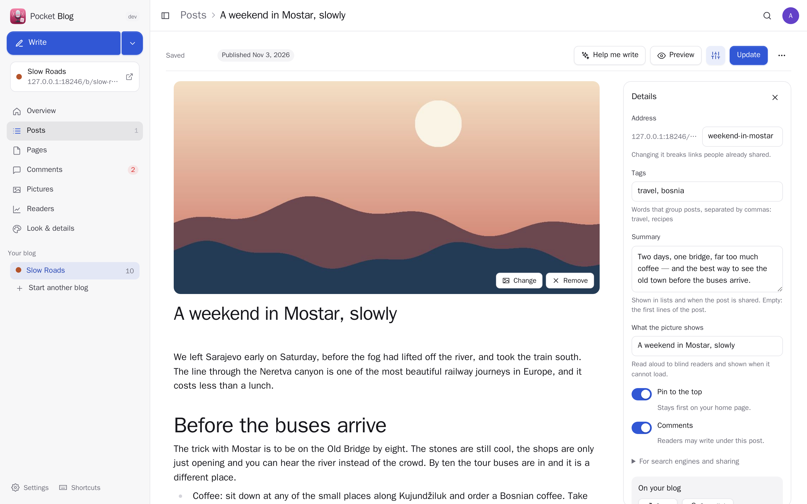
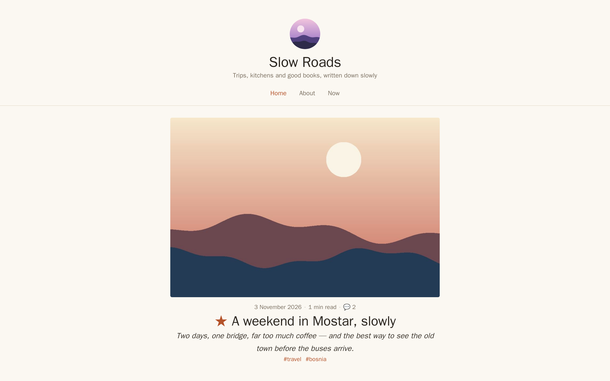
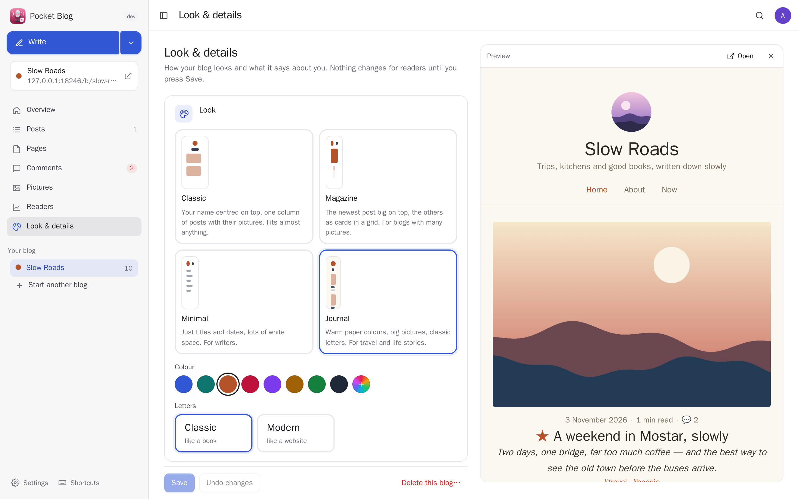
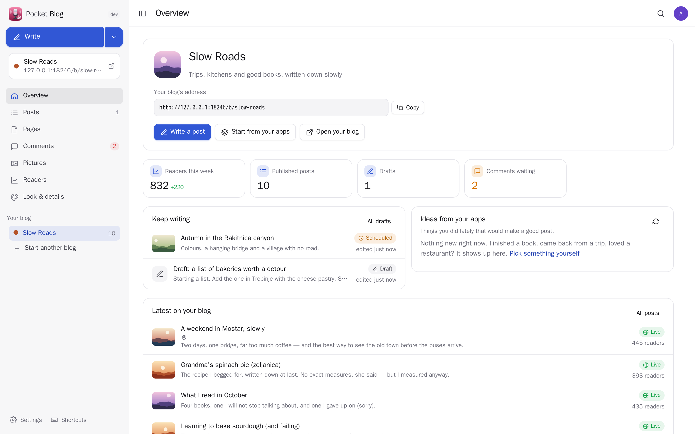
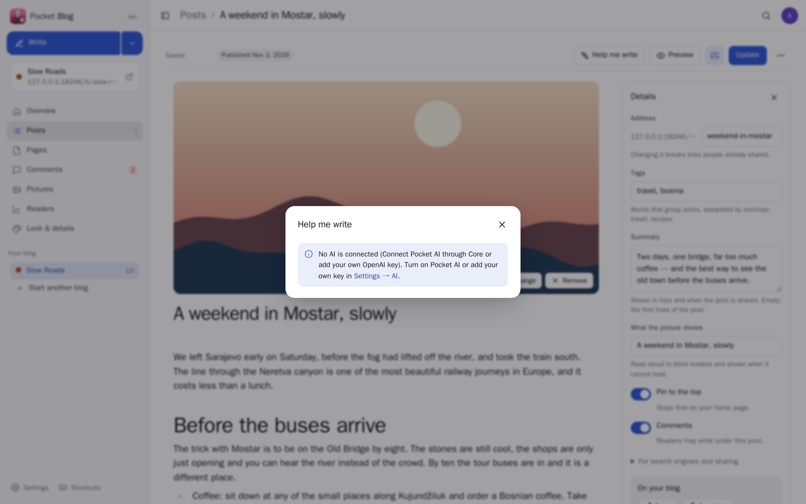
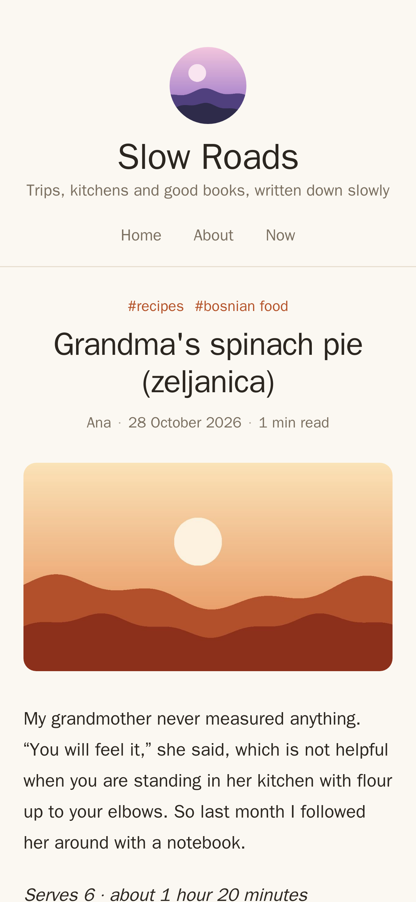
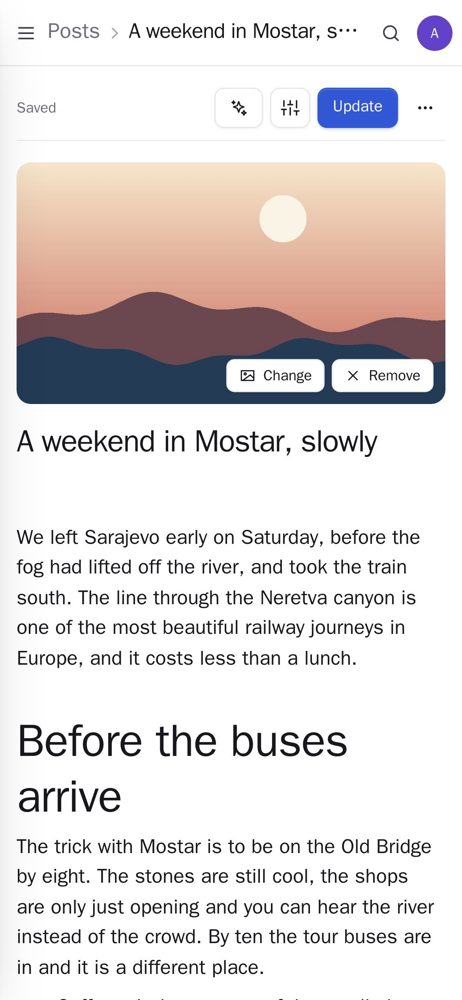

<p align="center"></p>
<h1 align="center">Pocket Blog</h1>
<p align="center">Your own blog, made without any programming: give it a name, pick one of four looks and a colour, write in an editor that shows the post as it will read, and press Publish. Pocket AI helps when you are stuck — a first version from one sentence, better wording, titles, a summary, a translation — and a post can start from what is already in your other apps: a trip, a book you finished, a restaurant you loved, a recipe, a film, a note or a voice memo. Readers get fast pages with no trackers, an RSS feed and comments you approve. Bring your old posts from WordPress or Markdown, and take everything with you as files or a ready website.<br>One Go binary, one SQLite file, one volume. Part of the Pocket apps; works on its own too.</p>
<p align="center">
  <a href="https://github.com/abjelosevic88/pocket-homelab-blog/actions"></a>
  <a href="https://github.com/abjelosevic88/pocket-homelab-blog/pkgs/container/pocket-homelab-blog"></a>
  <a href="LICENSE"></a>
</p>

---

<p align="center"></p>

<table>
  <tr>
    <td width="50%"></td>
    <td width="50%"></td>
  </tr>
  <tr>
    <td align="center"><sub>What readers see: fast pages without scripts or trackers, light and dark, on any screen.</sub></td>
    <td align="center"><sub>Pick a look, a colour and letters, and watch your real blog change next to it.</sub></td>
  </tr>
  <tr>
    <td width="50%"></td>
    <td width="50%"></td>
  </tr>
  <tr>
    <td align="center"><sub>Your address, readers this week, drafts to finish and ideas from your other apps.</sub></td>
    <td align="center"><sub>“Help me write”: Pocket AI as a patient editor; nothing changes until you press Use this.</sub></td>
  </tr>
  <tr>
    <td width="50%"></td>
    <td width="50%"></td>
  </tr>
  <tr>
    <td align="center"><sub>A recipe post on a phone.</sub></td>
    <td align="center"><sub>Writing on the phone works the same way.</sub></td>
  </tr>
</table>

## What it does

- **Start in three steps**: what it is about (Pocket AI can suggest a name, a line under it and a few words about you), how it looks, its address. An About page is made for you.
- **Write as it will read**: headings, lists, quotes, pictures, tables and links in a Milkdown editor — type `/` for a block, select text to format it, drop or paste a photo straight in. Everything saves by itself; nothing is public until you press **Publish**, now or at a time you pick.
- **Help me write** (Pocket AI through Core, or your own OpenAI-compatible key): a first version from a sentence, a plan, better wording, spelling only, shorter, richer, another tone, keep writing, rewrite the selected part, five titles, the summary and tags, a translation — in your blog's language and the voice you describe. Every answer is shown first.
- **Start from your apps**: a trip from Pocket Travel, a place from Pocket Places, a book with your rating and quotes from Pocket Bookshelf, a recipe with its ingredients and photo from Pocket Kitchen, a film with its poster from Pocket Watch, a note with its pictures from Pocket Notes, a voice memo from Pocket Voice — as an AI-written first draft or a tidy template. The overview suggests what you did lately.
- **Four looks** (Classic, Magazine, Minimal, Journal), any colour, book or web letters, light and dark by themselves, your picture, a menu of pages and links, your profiles, a footer — with a live preview of the real blog.
- **For readers**: pages rendered on the server with no JavaScript at all, RSS, a sitemap, search, tags, an archive, the previous and next post, YouTube and Vimeo videos from a link on its own line, and share previews.
- **Comments you approve** (or open, or off): a hidden field and a signed form keep robots out, a few per reader every ten minutes, answer from the app.
- **Readers, without tracking**: counted here without cookies, once a day per post, robots left out; per day and the most read posts.
- **Share a draft** with a private link before it goes out; **schedule** posts; **pin** one to the top.
- **Pictures** are made at most 2400 px and lose their hidden camera data (where they were taken).
- **Several blogs** per person, **everyone their own** on one box: each person has their own blogs, pictures, settings and connections; admins see no one else's drafts.
- **Bring posts in** from WordPress (Tools → Export), Markdown files from Hugo, Jekyll or Obsidian, or a Pocket Blog export — twice is the same as once. **Take everything out** as JSON, as Markdown with the pictures, or as a ready static website for any host.
- **Your own web address**: give a blog a domain, or serve only the blogs on a public hostname (`PUBLIC_URL`) while the app stays private.
- **Pushes** through Apprise, ntfy or a webhook: a new comment, a scheduled post going out, a morning note about yesterday's readers.

## Run it

```sh
docker run -d --name pocket-blog -p 8080:8080 -v ./data:/data \
  -e BASE_URL=https://blog.example.com -e SECURE_COOKIES=true \
  ghcr.io/abjelosevic88/pocket-homelab-blog:latest
```

or `docker compose up -d` with [docker-compose.yml](docker-compose.yml). Open it, create the first account, and the app walks you through making your blog; readers find it at `https://blog.example.com/b/<address>/`. All options: [docs/configuration.md](docs/configuration.md). API: [docs/api.md](docs/api.md).

## With Pocket Core

Set `CORE_URL` and `CORE_REGISTRATION_KEY` and Blog joins the box: people sign in with Pocket Core, Pocket AI helps them write, and through app links each person's posts can start from their own Pocket apps with nothing to paste (Blog only reads there):

| App | What a post takes from it | Scopes |
|---|---|---|
| Pocket Travel | a trip: where, when, what you planned and noted | `trips:read` |
| Pocket Places | a place: what it is, your rating, notes and visits | `places:read` |
| Pocket Bookshelf | a book: your rating, review and saved quotes | `books:read` |
| Pocket Kitchen | a recipe: ingredients, steps, photo; what you cooked lately | `recipes:read`, `cooklog:read` |
| Pocket Watch | a film or show, with its poster | `watching:read` |
| Pocket Notes | a note with its pictures; notes tagged #blog as ideas | `notes:read` |
| Pocket Voice | a voice memo, tidied | `voice:read` |
| Pocket AI | writing help; the Ask button on every page | inference |

Other apps can read your blog (`blog:read`: Pocket Day writes what you published into your journal, Pocket Search finds your posts, Pocket AI answers "how did my Mostar post do?") and start drafts for you (`blog:write`: "turn my trip to Lisbon into a blog post" in Pocket AI), changing only the posts they started. Events on the bus: `blog.post_published`, `blog.comment_received`. Without Core every connection can be made directly with a URL and a token; the Core-only choices stay visible, greyed out.

## Develop

```sh
make dev     # API on :8080 with demo data + Vite on :5173
make test    # go vet, go test, tsc
make         # web + binary
```

`node scripts/screenshots.mjs` takes the screenshots above from a demo instance and fails on any browser error. MIT licensed. The editor is [Milkdown](https://milkdown.dev) (MIT); Markdown by [goldmark](https://github.com/yuin/goldmark) (MIT); WordPress import with [html-to-markdown](https://github.com/JohannesKaufmann/html-to-markdown) (MIT).
